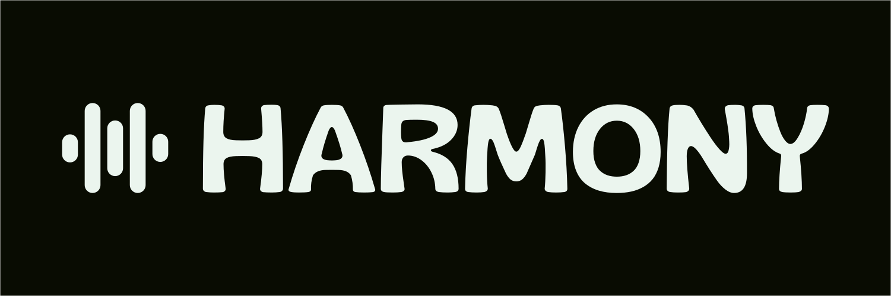

<p align="center">
  <a href="https://nexora.dev">
    
  </a>
</p>

<p align="center">
  <h1 align="center">Harmony</h1>
  <p align="center"><strong>Reproductor de música multiplataforma con Flutter + Dart + Rust</strong></p>
  <p align="center">Ligero, modular y eficiente. Arquitectura limpia con núcleo en Rust y UI en Flutter para máxima portabilidad entre Linux y Windows.</p>
</p>

<p align="center">
  
  
  
  
  
</p>

---

## Tabla de Contenidos

- [Estado del proyecto](#estado-del-proyecto)
- [Acerca de](#acerca-de)
- [Características principales](#características-principales)
- [Tecnologías y Stack](#tecnologías-y-stack)
- [Requisitos previos](#requisitos-previos)
- [Instalación y Configuración](#instalación-y-configuración)
- [Uso](#uso)
- [Estructura del proyecto](#estructura-del-proyecto)
- [Empaquetado](#empaquetado)
- [Hoja de ruta](#hoja-de-ruta)
- [Contribuir](#contribuir)
- [Seguridad](#seguridad)
- [Licencia](#licencia)

---

## Estado del proyecto

> **Estado actual:** Activo / En desarrollo.

## Acerca de

**Nexora** es un reproductor de música multiplataforma desarrollado por **Nexora Labs Co.** Diseñado con una arquitectura modular que separa completamente la lógica de audio del núcleo Rust de la interfaz Flutter, permitiendo una gran portabilidad, rendimiento nativo y facilidad de extensión hacia fuentes en la nube (WebDAV, Subsonic/Navidrome, Google Drive).

## Características principales

- **Arquitectura híbrida:** UI en Flutter/Dart + Lógica pesada en Rust para máximo rendimiento.
- **Audio nativo multiplataforma:** Soporte para WASAPI (Windows), PipeWire/PulseAudio/ALSA (Linux) mediante `cpal`.
- **Decodificación universal:** Soporte para MP3, FLAC, OGG, WAV, M4A, OPUS, AAC con `rodio` y `symphonia`.
- **Escaneo de biblioteca:** Detección automática de metadatos con `lofty` (ID3, Vorbis, FLAC tags).
- **Interfaz moderna:** Material 3 con tema claro/oscuro adaptable al sistema.
- **Preparado para la nube:** Estructura extensible para futuras integraciones con servicios remotos.
- **Empaquetado nativo:** Generación de `.deb` para Linux y `.exe` para Windows.

## Tecnologías y Stack

| Componente              | Tecnología                                                                              | Propósito                                 |
| ----------------------- | --------------------------------------------------------------------------------------- | ----------------------------------------- |
| **UI Framework**        | [Flutter 3.x](https://flutter.dev/)                                                     | Interfaz multiplataforma con Material 3   |
| **Lenguaje UI**         | [Dart](https://dart.dev/)                                                               | Lógica de presentación y estado           |
| **Core Engine**         | [Rust](https://www.rust-lang.org/)                                                      | Motor de audio, biblioteca, metadatos     |
| **Rust-Flutter Bridge** | [flutter_rust_bridge](https://github.com/fzyzcjy/flutter_rust_bridge)                   | Bindings seguros entre Rust y Dart        |
| **Audio Backend**       | [cpal](https://github.com/RustAudio/cpal) + [rodio](https://github.com/RustAudio/rodio) | Reproducción nativa multiplataforma       |
| **Decodificación**      | [symphonia](https://github.com/pdeljanov/Symphonia)                                     | Decodificación de múltiples formatos      |
| **Metadatos**           | [lofty](https://github.com/Serial-ATA/lofty-rs)                                         | Lectura/escritura de tags ID3/FLAC/Vorbis |
| **Base de datos**       | [rusqlite](https://github.com/rusqlite/rusqlite)                                        | Almacenamiento de biblioteca local        |

## Requisitos previos

Antes de comenzar, asegúrate de contar con lo siguiente en tu entorno de desarrollo:

- **[Flutter SDK](https://docs.flutter.dev/get-started/install)** >= 3.3.0
- **[Rust Toolchain](https://rustup.rs/)** >= 1.75 (con `cargo`)
- **[flutter_rust_bridge_codegen](https://cjycode.com/flutter_rust_bridge/)** v2.4.0
- **Linux:** `libgtk-3-dev`, `libasound2-dev`, `libpulse-dev` (para desarrollo)
- **Windows:** Visual Studio Build Tools con C++ (para desarrollo)

## Instalación y Configuración

Clona el repositorio y configura el entorno inicial:

```bash
# 1. Clonar el repositorio
git clone https://github.com/Nexora-Company/Nexora.git
cd Nexora

# 2. Instalar dependencias Flutter
cd nexora_app
flutter pub get
cd ..

# 3. Instalar flutter_rust_bridge_codegen
cargo install flutter_rust_bridge_codegen@2.4.0

# 4. Generar bindings Rust-Dart
cd nexora_app
flutter_rust_bridge_codegen generate
cd ..
```

## Uso

### Modo desarrollo

```bash
# Ejecutar en Linux
cd nexora_app
flutter run -d linux

# Ejecutar en Windows
flutter run -d windows
```

### Build de producción

```bash
# Build para Linux
cd nexora_app
flutter build linux --release

# Build para Windows
flutter build windows --release
```

## Estructura del proyecto

```text
Nexora/
├── nexora_app/           # Aplicación Flutter (UI + Dart)
│   ├── lib/
│   │   ├── main.dart
│   │   ├── services/     # AudioService (proxy a Rust)
│   │   ├── ui/           # Pantallas, widgets, tema
│   │   ├── providers/    # Estado global con Provider
│   │   └── bridge/       # Bindings generados por flutter_rust_bridge
│   └── pubspec.yaml
├── rust/                 # Workspace Rust
│   └── crates/
│       └── nexora_core/  # Núcleo: audio, library, models, api
├── rust_builder/         # Glue para integración Flutter-Rust
├── assets/               # Iconos, imágenes, temas
├── packaging/            # Recursos para empaquetado (.deb, .exe)
├── docs/                 # Documentación técnica
└── README.md
```

## Empaquetado

### Generar paquete .deb (Linux)

```bash
# Tras flutter build linux --release
mkdir -p nexora_0.1.0_amd64/{DEBIAN,opt/nexora,usr/share/applications,usr/share/icons/hicolor/256x256/apps}
cp -r nexora_app/build/linux/x64/release/bundle/* nexora_0.1.0_amd64/opt/nexora/
cp packaging/linux/nexora.desktop nexora_0.1.0_amd64/usr/share/applications/
cp assets/icons/nexora.png nexora_0.1.0_amd64/usr/share/icons/hicolor/256x256/apps/
dpkg-deb --build nexora_0.1.0_amd64
```

### Generar instalador .exe (Windows)

Tras `flutter build windows --release`, empaqueta el contenido de `nexora_app/build/windows/x64/runner/Release/` utilizando **Inno Setup** o **NSIS** con los recursos de `packaging/windows/`.

## Hoja de ruta

- [x] Migración a Flutter + Dart + Rust
- [x] Motor de audio con cpal/rodio/symphonia
- [x] Escaneo de biblioteca con metadatos
- [x] Interfaz base con Material 3
- [ ] Soporte completo para playlists
- [ ] Integración WebDAV
- [ ] Integración Subsonic/Navidrome
- [ ] Integración Google Drive
- [ ] Soporte MPRIS (Linux)
- [ ] Soporte SMTC (Windows)
- [ ] Sistema de carátulas y cache

## Contribuir

Consulta nuestra [Guía de Contribución](CONTRIBUTING.md) para conocer el flujo de trabajo, convenciones de commits (`Conventional Commits`) y proceso de Pull Request.

## Seguridad

Si descubres alguna vulnerabilidad de seguridad, por favor repórtala de forma privada siguiendo nuestra [Política de Seguridad](SECURITY.md). **No** crees un issue público.

## Licencia

Este proyecto está licenciado bajo **[PolyForm Noncommercial License 1.0.0](LICENSE)**. Gratuito para uso no comercial. Código visible.
